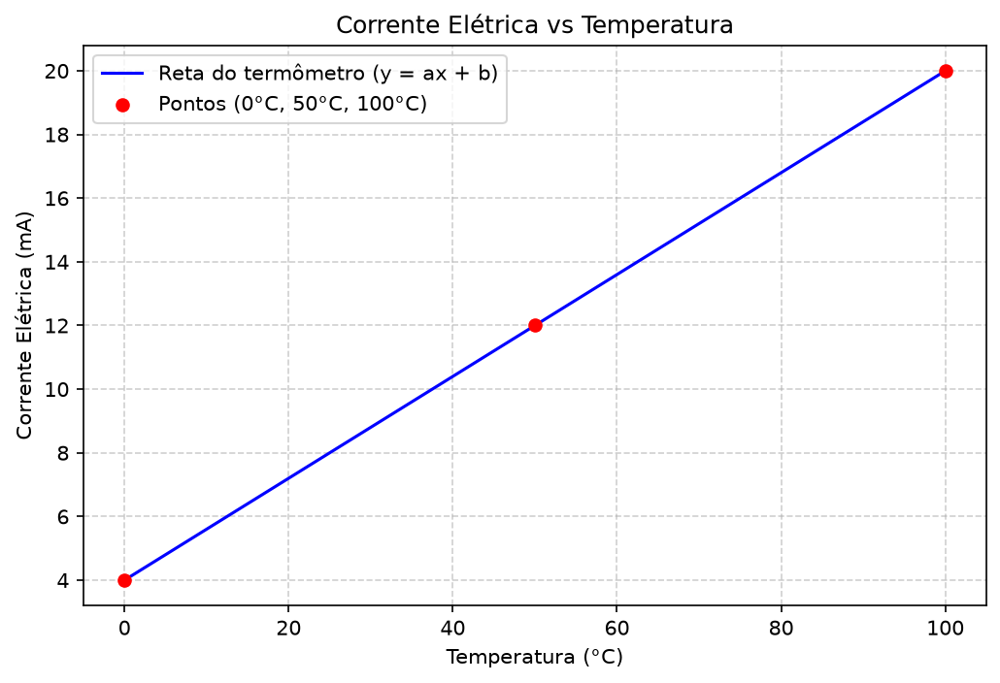
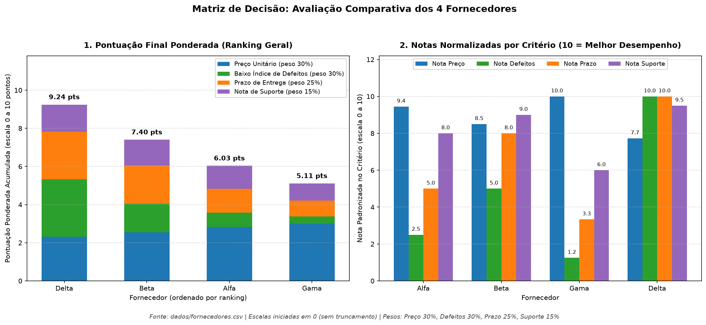
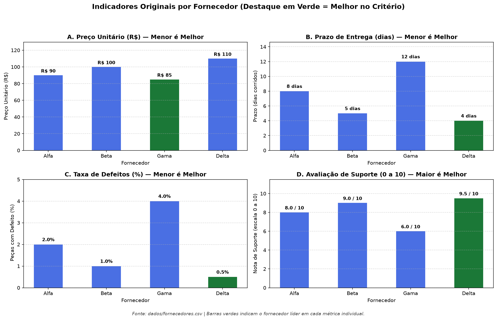
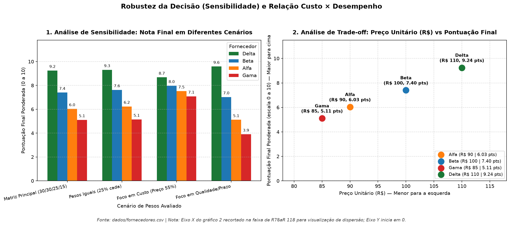

# Análise de Dados com Skills e Python (Aula 04 — Antigravity)

Repositório com os exercícios práticos de Python, análise de dados, visualização com Matplotlib e uso de **Skills** para tomada de decisão e auditoria de qualidade de dados.

---

## Estrutura do Projeto

```text
├── .agents/skills/          # Skills do projeto
│   ├── chart-image/         # Boas práticas para criação e revisão visual de gráficos
│   ├── conferir-csv/        # Auditoria de estrutura e qualidade de bases CSV
│   └── decision-matrix/     # Matriz de decisão ponderada e análise de sensibilidade
├── dados/                   # Dados originais de entrada (não alterados)
│   ├── fornecedores.csv
│   └── fornecedores_erro.csv
├── resultados/              # Gráficos (.png) e relatórios (.md) gerados pelos scripts
│   ├── grafico_termometro.png
│   ├── grafico_fornecedores.png
│   ├── grafico_metricas_originais.png
│   ├── grafico_sensibilidade_fornecedores.png
│   ├── relatorio_fornecedores.md
│   └── qualidade.md
├── AGENTS.md                # Combinados e regras de trabalho do projeto
├── termometro.py            # Equação linear (4–20 mA vs 0–100 °C), avisos e gráfico
├── fornecedores.py          # Matriz de decisão e gráficos dos 4 fornecedores
└── conferir_csv.py          # Auditoria de qualidade da base fornecedores_erro.csv
```

---

## O que cada script faz

### 1. `termometro.py` — Calibração de Termômetro (Equação da Reta)
- Calcula os coeficientes `A = 0.16` e `B = 4.0` da equação `y = ax + b` a partir dos pontos `(0 °C, 4 mA)` e `(100 °C, 20 mA)`.
- Calcula a corrente elétrica para `x = 50 °C` (`12.0 mA`).
- Exibe avisos caso a temperatura saia da faixa de `0 a 100 °C` ou a corrente saia de `4 a 20 mA`.
- Classifica a temperatura em **Baixa** (até 30 °C), **Média** (até 60 °C) ou **Alta** (acima de 60 °C).
- Gera o gráfico em `resultados/grafico_termometro.png`.



---

### 2. `fornecedores.py` — Matriz de Decisão e Gráficos (`decision-matrix` + `chart-image`)
Avalia 4 fornecedores (`Alfa`, `Beta`, `Gama` e `Delta`) a partir de `dados/fornecedores.csv` considerando **Preço Unitário (30%)**, **Qualidade/Defeitos (30%)**, **Prazo de Entrega (25%)** e **Suporte (15%)**:
- **Vencedor:** **Delta** (`9.24 / 10`), destacando-se pelo menor prazo (`4 dias`), menor taxa de defeitos (`0.5%`) e melhor suporte (`9.5`).
- Gera o relatório completo em [resultados/relatorio_fornecedores.md](resultados/relatorio_fornecedores.md).
- Gera 3 painéis gráficos revisados com a skill `chart-image`:





---

### 3. `conferir_csv.py` — Auditoria de Qualidade de Dados (`conferir-csv`)
Analisa a estrutura e a qualidade do arquivo `dados/fornecedores_erro.csv` sem modificar o arquivo original:
- Identifica **2 valores ausentes**: `preco_unitario` vazio no fornecedor `Delta` (linha 5) e `suporte_nota` vazio no fornecedor `Beta` (linha 3).
- Salva o diagnóstico detalhado e os tratamentos propostos em [resultados/qualidade.md](resultados/qualidade.md).

---

## Como executar o projeto na sua máquina

1. Crie o ambiente virtual `.venv` e instale as dependências:
   ```powershell
   python -m venv .venv
   .\.venv\Scripts\pip install matplotlib
   ```
2. Execute qualquer um dos scripts usando o Python da `.venv`:
   ```powershell
   .\.venv\Scripts\python termometro.py
   .\.venv\Scripts\python fornecedores.py
   .\.venv\Scripts\python conferir_csv.py
   ```

